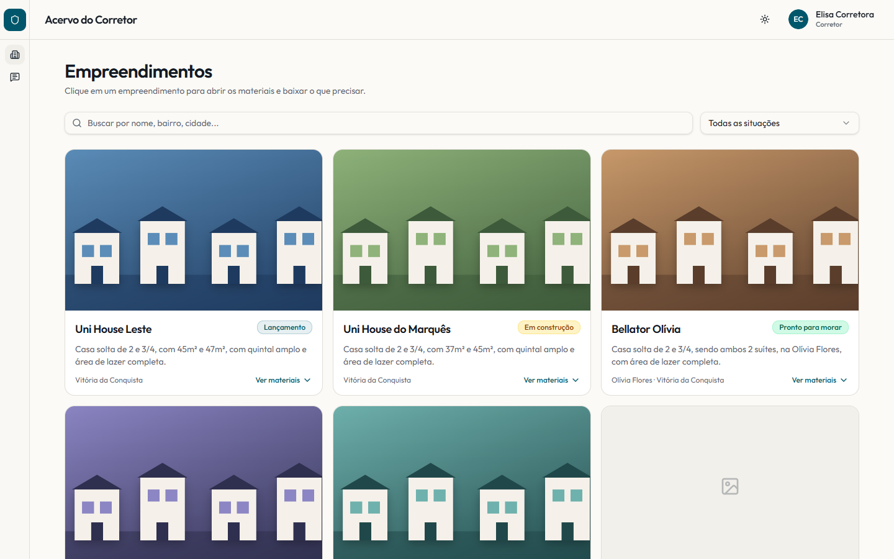
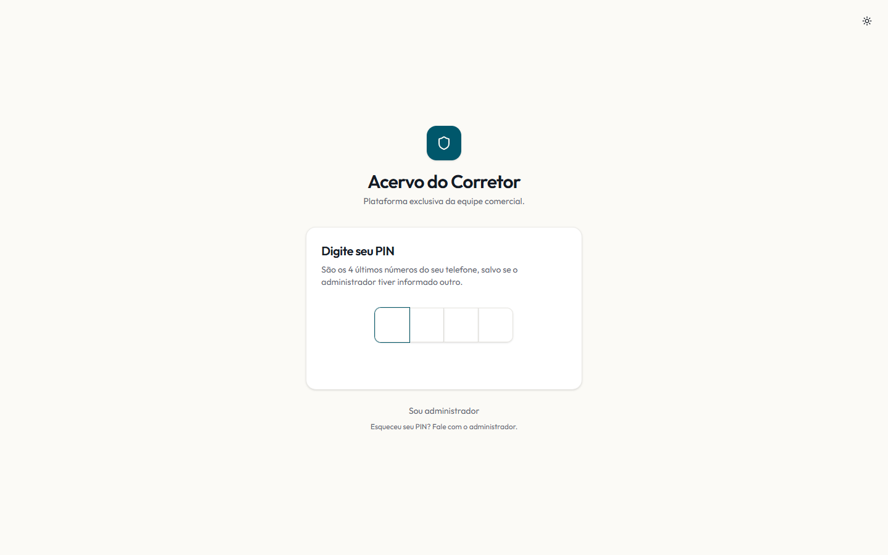
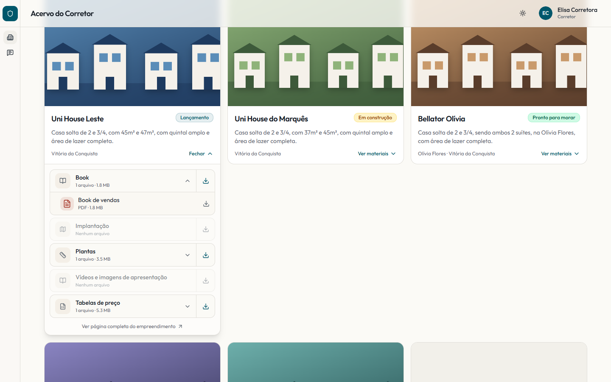
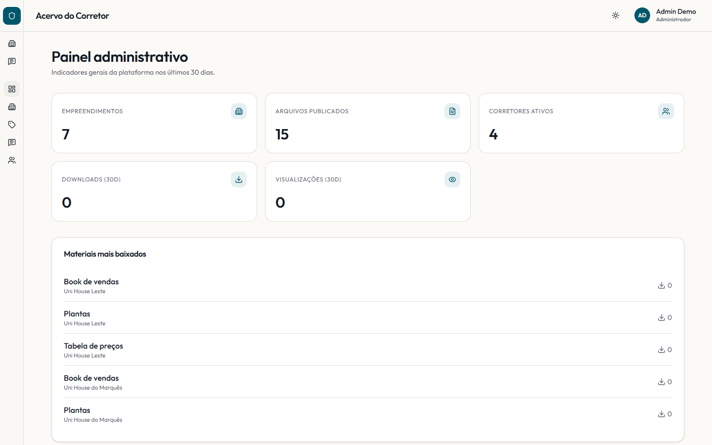
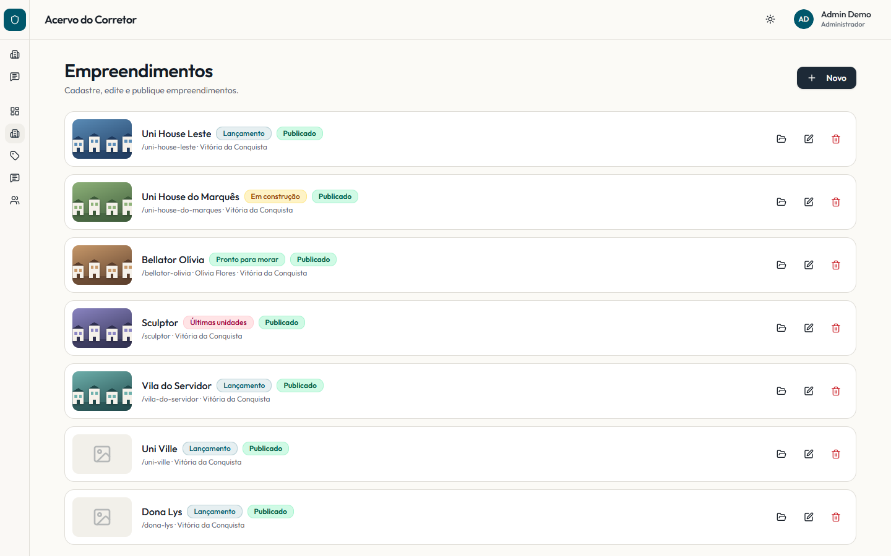
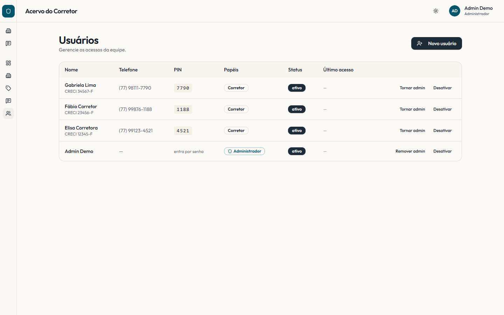

# Acervo do Corretor

Plataforma interna onde os corretores da construtora encontram, num só lugar, todo o material comercial de cada empreendimento: book de vendas, plantas, implantação, tabelas de preço, imagens e scripts de abordagem.

**No ar:** https://acervo-do-corretor.leadrouter.workers.dev · deploy automático a cada push na `main`.



---

## O problema

O material de vendas vivia espalhado em pastas do Drive, grupos de WhatsApp e no computador de quem montou. Na prática:

- o corretor perdia tempo procurando o arquivo e, muitas vezes, mandava ao cliente uma **tabela de preço vencida**;
- não havia como saber **quais materiais eram usados** nem por quem;
- o acesso precisava ser **simples para o corretor** (que entra pelo celular, na correria) e **controlado pela empresa** (corretor desligado perde o acesso na hora).

## A solução

Um app web com dois perfis:

| Perfil | O que faz |
|---|---|
| **Corretor** | Entra com um **PIN de 4 dígitos**, vê os empreendimentos publicados, filtra por situação, abre os materiais por categoria e baixa só o que precisa. Também tem os **scripts rápidos** de abordagem, para copiar e colar. |
| **Administrador** | Entra com e-mail e senha. Cadastra empreendimentos (capa, galeria, destaques, situação comercial), sobe arquivos, publica ou deixa em rascunho, gerencia corretores e PINs e acompanha os downloads e as visualizações. |

| Login por PIN | Materiais por categoria |
|---|---|
|  |  |

| Painel administrativo | Cadastro de empreendimentos |
|---|---|
|  |  |



> Os prints usam dados de demonstração: corretores, telefones e capas são fictícios.

---

## Stack

| Camada | Tecnologia |
|---|---|
| Framework | **TanStack Start** (React 19 + Vite), com roteamento por arquivos e server functions |
| UI | Tailwind CSS v4 · shadcn/ui (Radix) · lucide-react |
| Dados no cliente | TanStack Query · React Hook Form + Zod |
| Hospedagem | **Cloudflare Workers** (build via Nitro, preset `cloudflare-module`) |
| Banco | **Cloudflare D1** (SQLite), com migrations em `migrations/` |
| Arquivos | **Cloudflare R2** (bucket privado) |
| Testes | Runner próprio sobre `node:sqlite` (~119 verificações, sem rede) |
| CI/CD | GitHub Actions: testes → migrations remotas → deploy |

## Como rodar

```bash
npm install
node node_modules/wrangler/bin/wrangler.js d1 migrations apply acervo --local   # primeira vez
npm run dev:cloudflare     # http://localhost:8787, com D1 e R2 simulados localmente
npm run test               # suítes de schema, acesso, login e arquivos
```

Use `dev:cloudflare`, e não `dev`: o banco e os arquivos só existem dentro do runtime da Cloudflare. Na primeira vez que o site abre sem administrador, aparece a tela de **Primeiro acesso** para criar o admin.

---

## Decisões técnicas

### 1. Sem sistema de autenticação: PIN de 4 dígitos com bloqueio por IP
O corretor entra pelo celular, na rua. E-mail e senha geravam chamado de suporte sem proteger nada a mais. O PIN padrão são os 4 últimos dígitos do telefone, e o admin pode trocar.
- **3 erros bloqueiam por 15 minutos**, contados **por IP**, porque o PIN chega sem usuário e não dá para contar "por pessoa". É isso que impede um robô de varrer as 10.000 combinações.
- O PIN fica **em texto no banco** de propósito: o admin precisa conseguir reenviá-lo, e quem protege o acesso é o bloqueio.
- A **senha do admin** é diferente: vai cifrada com **PBKDF2** (100.000 iterações, o teto do runtime da Cloudflare).
- A sessão é um cookie **assinado com HMAC** (`SESSION_SECRET`).

### 2. Supabase → Cloudflare D1 + R2
O backend começou no Supabase e foi trocado em 28/07. Com o login por PIN, o Auth e o RLS do Supabase deixaram de servir, e sobravam dois fornecedores e uma cota de 5 GB de download por mês. Na Cloudflare ficou **uma conta só, custo zero e download ilimitado** (o R2 não cobra saída). O piloto, com 10 corretores e ~800 MB, cabe na camada gratuita.

### 3. Regras de acesso em código, cobertas por teste
O D1 não tem RLS. As regras de quem vê e escreve o quê moram em `src/lib/db/access.ts`, e o `tests/acesso.test.ts` roda o motor de consultas **real** contra um SQLite **real** para provar cada porta: o corretor não vê rascunho, não lê dados de colega e não escreve onde não deve. Teste vermelho bloqueia o deploy.

### 4. Arquivos sem endereço público
O bucket R2 é privado. Todo arquivo passa por `/arquivos/<pasta>/<caminho>`, que confere a sessão, recusa caminhos maliciosos (`..`, barras invertidas) e só então entrega, com `cache-control: private`.

### 5. Interface `db.from(...)` preservada
Na troca de backend, a API de consulta das telas (`db.from("x").select().eq()`) foi mantida e reimplementada sobre o D1 (`client.ts → server.ts → query.ts`). As 19 telas migraram sem reescrita.

### 6. Pipeline que não publica quebrado
O CI roda os testes, aplica as migrations no D1 remoto e só depois publica o Worker. As ferramentas são chamadas via `node node_modules/...` em vez dos atalhos `.cmd`, que a política de grupo da máquina de desenvolvimento bloqueia.

### 7. npm como único gerenciador
Um lockfile só (`package-lock.json`), usado por `npm ci` no CI. Misturar bun ou yarn dessincroniza as versões entre o PC e o servidor.

---

## Estrutura

```
src/
├── routes/                # páginas (TanStack Router, por arquivos)
│   ├── auth.tsx           # PIN, login do admin e primeiro acesso
│   └── _authenticated/    # área logada: empreendimentos, scripts, perfil, admin/*
├── components/acervo/     # componentes do produto (card, sidebar, badges...)
└── lib/db/                # acesso a dados: access, query, session, login, arquivos
migrations/                # schema e seed do D1
tests/                     # suítes que rodam sem servidor
.github/workflows/         # deploy.yml
```

Detalhes operacionais (infraestrutura, problemas conhecidos, histórico) ficam em [`CLAUDE.md`](CLAUDE.md).
